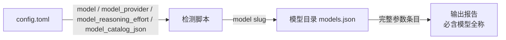

# Verify Real Model Details

一个集成到 AI Agent IDE（Codex）的技能（skill）：检测当前正在使用的模型，并输出该模型的**完整参数**，输出内容**必须包含模型全称**。

技能名：`show-current-model`

---

## 功能特性

- **自动检测当前模型**：读取 Agent IDE 的配置（Codex：`$CODEX_HOME/config.toml`），解析当前模型、提供方、推理强度等信息。
- **输出完整参数**：从模型目录（`model_catalog_json`，默认 `$CODEX_HOME/models.json`）中查找当前模型的完整参数条目，包括上下文窗口、最大上下文、截断策略、输入模态、支持的推理档位、工具支持等。
- **必含模型全称**：报告第一行始终输出模型的完整名称（`display_name` + `slug`），即使其他参数无法解析。
- **跨平台**：脚本兼容 Windows / macOS / Linux，正确处理 Windows 路径与中文输出。
- **安全**：自动剔除系统提示词模板（`model_messages` / `base_instructions`，它们不是模型参数）；绝不输出 API Key、Token 等敏感信息。
- **容错**：模型不在目录中时仍输出已知信息（名称、提供方、推理强度），并列出目录中可用的模型 slug 供核对。
- **只读**：技能仅读取配置与模型目录，不修改任何 IDE 配置。

---

## 安装

### 方式一：自动发现（推荐）

将本仓库克隆或下载到 Codex 的技能目录，例如：

```bash
git clone https://github.com/sapsapshen/verify-real-model-details.git \
  "$HOME/.codex/skills/show-current-model"
```

Windows（PowerShell）：

```powershell
git clone https://github.com/sapsapshen/verify-real-model-details.git `
  "$env:USERPROFILE\.codex\skills\show-current-model"
```

Codex 启动时会自动扫描 `~/.codex/skills` 下的技能，随后即可在对话中直接使用。

### 方式二：手动放置

将 `SKILL.md`、`agents/`、`references/`、`scripts/` 放入任意已注册的技能根目录（如 `~/.codex/skills/show-current-model/`）即可。

---

## 使用

在对话中直接说：

- “当前是什么模型？”
- “输出当前模型的完整参数”
- “Show current model”
- 或显式调用：`$show-current-model`

技能会自动执行以下流程：

1. 运行检测脚本：`python scripts/show_current_model.py`（Windows 可回退为 `py`）
2. 脚本读取 `$CODEX_HOME/config.toml`，解析：
   - `model` —— 当前模型 slug
   - `model_provider` —— 模型提供方
   - `model_reasoning_effort` —— 推理强度
   - `model_catalog_json` —— 模型目录路径（缺省回退到 `$CODEX_HOME/models.json`）
3. 在模型目录中按 `slug` / `id` / `model` / `name` 匹配当前模型，取出完整参数条目
4. 输出报告

### 命令行直接运行

```bash
# 人类可读报告
python scripts/show_current_model.py

# JSON 输出（便于程序处理）
python scripts/show_current_model.py --json
```

退出码：

| 退出码 | 含义 |
| --- | --- |
| 0 | 成功输出完整报告 |
| 2 | 配置中存在模型，但模型目录中没有对应条目 |
| 3 | 找不到配置或模型目录 |

---

## 输出示例

```text
当前模型（全称）: DeepSeek-V4-Flash
模型标识 (slug): deepseek-v4-flash
提供方: deepseek (base_url=https://api.deepseek.com/, wire_api=responses)
推理强度 (reasoning effort): xhigh
参数来源: C:\Users\sapsa\.codex\models.json

完整参数:
  slug: deepseek-v4-flash
  display_name: DeepSeek-V4-Flash
  description: Latest frontier agentic coding model.
  context_window: 1048576
  max_context_window: 1048576
  effective_context_window_percent: 95
  truncation_policy: {"mode": "tokens", "limit": 10000}
  input_modalities: ["text"]
  default_reasoning_level: high
  supported_reasoning_levels: [{"effort": "low", ...}, {"effort": "high", ...}, {"effort": "max", ...}]
  supports_parallel_tool_calls: True
  supports_search_tool: True
  ...（其余参数由模型目录决定）
```

---

## 工作原理



1. **定位配置**：优先使用环境变量 `CODEX_HOME`；未设置时默认 `~/.codex/config.toml`。
2. **解析配置**：使用 Python 标准库 `tomllib` 解析（Python < 3.11 时回退为正则解析顶层键）。
3. **查找模型目录**：优先使用 `model_catalog_json` 指定的路径，其次 `$CODEX_HOME/models.json`。
4. **匹配模型**：按 `slug` / `id` / `model` / `name` 匹配配置中的模型。
5. **输出**：模型全称 + 提供方 + 推理强度 + 完整参数；敏感字段自动脱敏，提示词模板自动排除。

---

## 目录结构

```text
verify-real-model-details/
├── SKILL.md                     # 技能定义：触发条件、工作流程、输出规则
├── agents/
│   └── openai.yaml              # UI 元数据（显示名、简短描述、默认提示词）
├── references/
│   └── ides.md                  # 其他 Agent IDE 的模型检测方法
├── scripts/
│   └── show_current_model.py    # 检测与报告脚本（跨平台）
├── README.md                    # 本文档
└── LICENSE
```

---

## 参数说明（常见字段）

| 字段 | 含义 |
| --- | --- |
| `slug` / `id` / `model` | 模型标识 |
| `display_name` | 模型全称（展示名） |
| `description` | 模型简介 |
| `context_window` | 上下文窗口大小（tokens） |
| `max_context_window` | 最大上下文窗口（tokens） |
| `effective_context_window_percent` | 实际可用上下文占比（%） |
| `truncation_policy` | 截断策略（模式与上限） |
| `input_modalities` | 支持的输入模态（文本/图像等） |
| `default_reasoning_level` / `supported_reasoning_levels` | 默认与可选的推理强度档位 |
| `supports_parallel_tool_calls` | 是否支持并行工具调用 |
| `supports_search_tool` | 是否支持搜索工具 |
| `minimal_client_version` | 最低客户端版本要求 |

> 注：具体字段以当前机器模型目录中的条目为准，技能原样输出，不做臆测。

---

## 注意事项与容错

- **模型全称必输出**：即使本地目录缺少参数条目，也会输出配置中解析到的模型名称与已知信息。
- **不输出密钥**：提供方配置中的 Token / Key 等字段不会出现在报告中。
- **排除提示词模板**：`model_messages`、`base_instructions` 属于系统提示词，不是模型参数，不会输出。
- **配置被覆盖时**：Codex 支持 `--model` 命令行参数与桌面端模型选择器，可能覆盖 `config.toml` 中的值。若报告与预期不符，请以实际会话为准，技能会注明参数来源。
- **其他 IDE**：Claude Code、Cursor、Windsurf 等的检测方法见 `references/ides.md`；其中部分 IDE 未提供稳定的本地配置键，需要向用户确认或查询官方文档。

---

## 许可

本项目基于仓库中的 [LICENSE](LICENSE) 发布。
