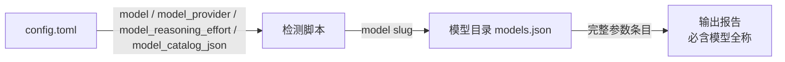

# Verify Real Model Details

[](https://github.com/sapsapshen/verify-real-model-details/actions/workflows/ci.yml)

一个集成到 AI Agent IDE（Codex）的技能（skill）：检测当前配置的模型，并输出该模型的**有效参数**，输出内容**必须包含模型全称**。

需要 Python 3.10 或更高版本。完整 TOML（配置档、提供方表、嵌套默认值）需要 Python 3.11+ 自带的 `tomllib`；更早版本只会解析顶层标量。

技能名：`show-current-model`

---

## 功能特性

- **自动检测当前模型**：读取 Codex 的 `$CODEX_HOME/config.toml`，解析当前模型、提供方、推理强度、推理摘要、服务档等信息。
- **支持配置档**：`--profile NAME` 会把 `$CODEX_HOME/NAME.config.toml` 叠到基础配置上，与 `codex --profile NAME` 一致。旧式 `[profiles.NAME]` 和顶层 `profile = "NAME"` 不会被当成当前配置。
- **输出有效参数**：在模型目录条目上应用 Codex 自己会应用的覆盖项：`model_context_window`（不超过 `max_context_window`）、`model_auto_compact_token_limit`，以及 `tool_output_token_limit`（bytes 模式按 4 字节/token 换算）。
- **必含模型全称**：报告第一行始终输出模型的完整名称（`display_name` + `slug`）。配置里已经有模型名时，即使目录缺失或损坏也会先输出这个名称。
- **跨平台**：脚本兼容 Windows / macOS / Linux，正确处理 Windows 路径与中文输出。
- **安全**：剔除提示词模板（`model_messages`、`base_instructions`、`instructions_template`、`developer_instructions`、`compact_prompt`）；嵌套的密钥字段、URL 用户信息和查询参数中的密钥都会去掉。不读取 `auth.json`，也不展开 `env_key` 指向的环境变量。
- **容错**：模型不在目录中时仍输出已知信息，并列出目录中可用的模型 slug。仅当大小写不同且唯一匹配时，才回退到不区分大小写的条目。
- **只读**：技能只读取配置和模型目录，不修改任何 IDE 配置。

---

## 安装

### 方式一：自动发现（推荐）

将本仓库克隆或下载到 Codex 的技能目录，例如：

```bash
git clone https://github.com/sapsapshen/verify-real-model-details.git \
  "$HOME/.codex/skills/show-current-model"
```

Windows（PowerShell）：

```powershell
git clone https://github.com/sapsapshen/verify-real-model-details.git `
  "$env:USERPROFILE\.codex\skills\show-current-model"
```

Codex 启动时会自动扫描 `~/.codex/skills` 下的技能，随后即可在对话中直接使用。

### 方式二：手动放置

将 `SKILL.md`、`agents/`、`references/`、`scripts/` 放入任意已注册的技能根目录（如 `~/.codex/skills/show-current-model/`）即可。

---

## 使用

在对话中直接说：

- “当前是什么模型？”
- “输出当前模型的完整参数”
- “Show current model”
- 或显式调用：`$show-current-model`

技能会自动执行以下流程：

1. 运行检测脚本：`python scripts/show_current_model.py`（Windows 可回退为 `py`）。用户正在使用 `codex --profile NAME` 时加上 `--profile NAME`。
2. 脚本读取 `$CODEX_HOME/config.toml`（以及可选的配置档），解析：
   - `model` —— 当前模型 slug
   - `model_provider` —— 模型提供方
   - `model_reasoning_effort` —— 推理强度
   - `model_catalog_json` —— 模型目录路径（缺省回退到 `$CODEX_HOME/models.json`）
3. 在模型目录中按 `slug` / `id` / `model` / `name` 匹配当前模型，取出参数条目，再应用配置里的上下文窗口、自动压缩和工具输出上限
4. 输出报告

### 命令行直接运行

```bash
# 人类可读报告
python scripts/show_current_model.py

# JSON 输出（便于程序处理）
python scripts/show_current_model.py --json

# 与 `codex --profile deep-review` 相同的配置档
python scripts/show_current_model.py --profile deep-review

# 显式指定文件（相对路径相对当前工作目录）
python scripts/show_current_model.py --config /path/to/config.toml --catalog /path/to/models.json
```

`--profile` 与 `--config` 可以一起用：`--config` 替换基础 `config.toml`，配置档仍从 `$CODEX_HOME/<profile>.config.toml` 读取。

退出码：

| 退出码 | 含义 |
| --- | --- |
| 0 | 配置和模型目录都解析成功 |
| 2 | 配置中存在模型，但模型目录中没有对应条目（仍输出已知信息） |
| 3 | 找不到配置，或模型目录缺失、无法读取、格式无法识别。若已经解析到模型名，标准输出仍会带上该名称 |

---

## 输出示例

```text
当前模型（全称）: DeepSeek-V4-Flash
模型标识 (slug): deepseek-v4-flash
提供方: deepseek (base_url=https://api.deepseek.com/, wire_api=responses)
推理强度 (reasoning effort): xhigh
配置来源: C:\Users\sapsa\.codex\config.toml
参数来源: C:\Users\sapsa\.codex\models.json

完整参数:
  slug: deepseek-v4-flash
  display_name: DeepSeek-V4-Flash
  description: Latest frontier agentic coding model.
  context_window: 1048576
  max_context_window: 1048576
  effective_context_window_percent: 95
  truncation_policy: {"mode": "tokens", "limit": 10000}
  input_modalities: ["text"]
  default_reasoning_level: high
  supported_reasoning_levels: [{"effort": "low", ...}, {"effort": "high", ...}, {"effort": "max", ...}]
  supports_parallel_tool_calls: True
  supports_search_tool: True
  ...（其余参数由模型目录决定）
```

---

## 工作原理



1. **定位配置**：优先使用环境变量 `CODEX_HOME`；未设置时默认 `~/.codex/config.toml`。传入 `--profile` 时再叠加 `$CODEX_HOME/<profile>.config.toml`。
2. **解析配置**：使用 Python 标准库 `tomllib`（Python 3.11+）。解析失败或没有 `tomllib` 时，只读取顶层标量，并在报告里说明。
3. **查找模型目录**：`--catalog`，其次 `model_catalog_json`，再其次 `$CODEX_HOME/models.json`。目录可以是数组、`{"models": [...]}`、单个模型对象，或 slug 到对象的映射。
4. **匹配模型**：按 `slug` / `id` / `model` / `name` 精确匹配；只有唯一的大小写差异时才放宽。
5. **应用覆盖**：把配置里的上下文窗口、自动压缩阈值和工具输出上限写进参数条目，与当前 Codex 的元数据覆盖规则一致。
6. **输出**：模型全称 + 提供方 + 推理强度 + 有效参数；敏感字段和提示词模板不出现在报告中。

---

## 目录结构

```text
verify-real-model-details/
├── SKILL.md                     # 技能定义：触发条件、工作流程、输出规则
├── agents/
│   └── openai.yaml              # UI 元数据（显示名、简短描述、默认提示词）
├── references/
│   └── ides.md                  # Codex 与其他 Agent IDE 的模型检测方法
├── scripts/
│   └── show_current_model.py    # 检测与报告脚本（仅标准库）
├── tests/
│   └── test_show_current_model.py
├── .github/workflows/ci.yml     # Python 3.12 / 3.13 / 3.14
├── pyproject.toml
├── README.md
└── LICENSE
```

---

## 参数说明（常见字段）

| 字段 | 含义 |
| --- | --- |
| `slug` / `id` / `model` | 模型标识 |
| `display_name` | 模型全称（展示名） |
| `description` | 模型简介 |
| `context_window` | 上下文窗口大小（tokens） |
| `max_context_window` | 最大上下文窗口（tokens） |
| `effective_context_window_percent` | 实际可用上下文占比（%） |
| `truncation_policy` | 截断策略（模式与上限） |
| `input_modalities` | 支持的输入模态（文本/图像等） |
| `default_reasoning_level` / `supported_reasoning_levels` | 默认与可选的推理强度档位 |
| `supports_parallel_tool_calls` | 是否支持并行工具调用 |
| `supports_search_tool` | 是否支持搜索工具 |
| `minimal_client_version` | 最低客户端版本要求 |

> 注：具体字段以当前机器模型目录中的条目为准，技能原样输出，不做臆测。

---

## 注意事项与容错

- **模型全称必输出**：即使本地目录缺少参数条目，或目录文件缺失/损坏，只要配置里有顶层 `model`，报告第一行仍是该模型名称。
- **不输出密钥**：提供方表里的 token、header、`auth` 和 `experimental_bearer_token` 不会出现。`env_key` 只显示变量名。URL 中的用户信息和密钥查询参数会替换成 `[REDACTED]`。
- **排除提示词模板**：`model_messages`、`base_instructions`、`instructions_template`、`developer_instructions`、`compact_prompt` 属于提示词，不是模型参数。
- **配置档**：当前 Codex 使用 `$CODEX_HOME/<name>.config.toml` 配合 `--profile <name>`。写在 `[profiles.<name>]` 里的模型不会生效，脚本会提示，但不会改用那个模型。
- **新会话默认值**：`models.new_thread.model` 只是新会话默认值。顶层没有 `model` 时，脚本不会把它当成当前模型。
- **会话覆盖**：`codex --model` 和桌面端模型选择器可以覆盖文件里的值，但这种覆盖不一定写回 `config.toml`。报告注明配置来源；若与当前会话不一致，以会话为准。
- **其他 IDE**：Claude Code、Cursor、Windsurf 等的检测方法见 `references/ides.md`。

## 开发与测试

脚本没有第三方运行时依赖。测试使用 pytest：

```bash
python -m pip install pytest
python -m pytest
```

GitHub Actions 会在 Python 3.12、3.13 和 3.14 上运行同一套测试。

---

## 许可

本项目基于仓库中的 [LICENSE](LICENSE) 发布。
